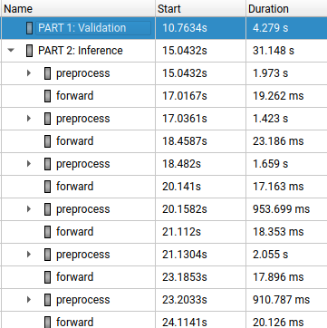

# Optimization log of model training and inference

## Preprocessing

During inference, forward pass of the model takes on average about 18 ms, While preprocessing takes 1.5-2 seconds (depending on the size of the Point Cloud).


Most of the time is spent loading .npz point cloud array file from disk.

the offending code is listed below:
```python
loaded    = np.load(file=sample_path / 'input' / 'lidar.npz')
intensity = torch.tensor(loaded['intensity']).to(device)
xyz       = torch.tensor(loaded['xyz'])
colors    = torch.zeros_like(xyz).to(device)
```

Work in progress
