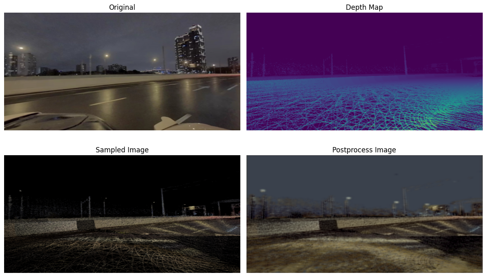
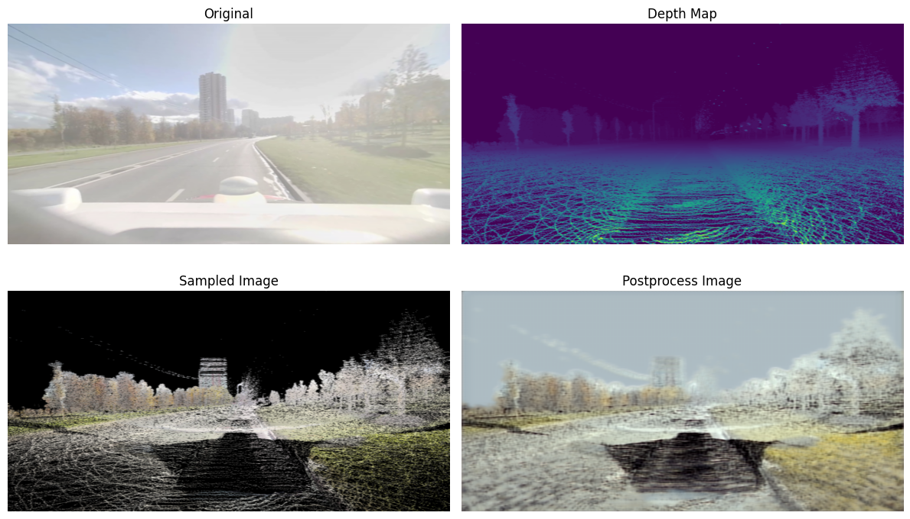
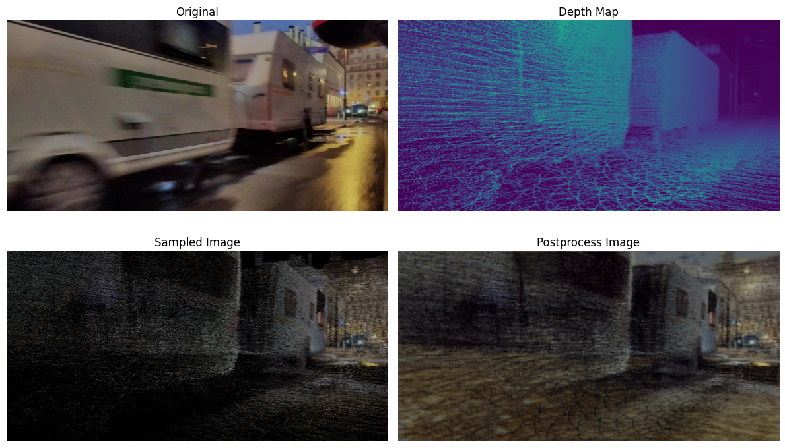

# Camera View Synthesis

A PyTorch-based camera view synthesis project that reconstructs RGB camera views from sparse LiDAR projections.

The project builds a six-channel input representation from LiDAR data and camera metadata, then uses a custom U-Net to generate a dense RGB image.

## Overview

The model takes a tensor with the following six channels:

1. **RGB sampled image** — RGB values obtained by projecting LiDAR points into camera views and sampling their colors.
2. **Validity mask** — indicates which image pixels contain a projected LiDAR point.
3. **Depth map** — inverse depth at valid projected pixels.
4. **Intensity map** — LiDAR intensity values.
5. **Additional input channels** — reserved/represented by the six-channel model input configuration.

<p align="center">
  
</p>

<p align="center">
  
</p>

<p align="center">
  
</p>

The current model is instantiated as:

```python
CustomUNet(depth=4, input_dim=6)
```

and produces a 3-channel RGB output.

## Model

The model is implemented in `model.py`.

### CustomUNet

The network consists of:

- A 7×7 convolutional input stem.
- Four contracting stages by default.
- Residual convolutional blocks.
- Strided convolutional downsampling.
- A residual bottleneck.
- Transposed-convolution upsampling.
- Skip connections between encoder and decoder stages.
- A 7×7 convolutional RGB output head.

The residual blocks use:

- Group Normalization
- GELU activation
- Two 3×3 convolutions
- Optional layer scaling
- DropPath regularization
- A residual/skip connection

The model expects input tensors shaped approximately as:

```text
[B, 6, H, W]
```

For the current test configuration:

```text
[1, 6, 512, 512]
```

and produces:

```text
[1, 3, 512, 512]
```

## Preprocessing

The preprocessing pipeline is implemented in `preprocessing.py`.

For each sample, `build_lidar_projections()`:

1. Loads the LiDAR point cloud from `input/lidar.npz`.
2. Loads LiDAR `xyz` coordinates and intensity values.
3. Loads camera intrinsics and camera-to-world poses from `meta.json`.
4. Projects LiDAR points into each camera image.
5. Keeps the closest LiDAR point for each image pixel.
6. Samples RGB values from the corresponding camera images.
7. Builds:
   - RGB LiDAR projection
   - validity mask
   - inverse-depth map
   - intensity map
8. Concatenates the channels into the model input.
9. Resizes the resulting tensor to 512×512.

The projection uses the camera matrix:

```text
P = K @ inverse(c2w)[:3]
```

and filters points that are outside the camera frustum or behind the camera.

## Dataset Structure

The preprocessing code expects samples to have a structure similar to:

```text
cv_dataset_small/
├── train/
│   └── <sample>/
│       ├── meta.json
│       ├── input/
│       │   ├── lidar.npz
│       │   ├── t0/
│       │   │   ├── front.jpg
│       │   │   ├── left_fwd.jpg
│       │   │   ├── left_bwd.jpg
│       │   │   ├── right_fwd.jpg
│       │   │   ├── right_bwd.jpg
│       │   │   └── rear.jpg
│       │   └── t1/
│       │       └── ...
│       └── target/
│           └── <target_camera>.jpg
└── test/
    └── <sample>/
        └── ...
```

`meta.json` contains camera intrinsics, camera poses, and the target camera name.

## Dependencies

The source code uses the following main Python packages:

```text
torch
torchvision
numpy
matplotlib
tqdm
torch-scatter
mlflow
timm
torchinfo
```

Install the standard dependencies with:

```bash
pip install torch torchvision numpy matplotlib tqdm mlflow timm torchinfo
```

`torch-scatter` should be installed using the version compatible with the installed PyTorch/CUDA version.

## Training

The training code uses:

```python
torch.optim.Adam
```

with:

```text
learning rate = 0.001
loss = L1Loss
```

The intended training setup uses the generated LiDAR projection tensors as inputs and RGB camera images as targets.

MLflow is used for experiment tracking and logging training/validation losses.

A checkpoint is saved as:

```text
best_model.pt
```

when a new best validation loss is obtained.

## Cached Preprocessing

The code contains support for caching preprocessed tensors in:

```text
Cached_images/
```

Cached tensors are stored per sample and camera/timestamp, using filenames such as:

```text
front_t0.pt
front_t1.pt
<target_camera>_target.pt
```

The caching/training section is currently disabled/commented out in `preprocessing.py` and can be enabled when needed.
